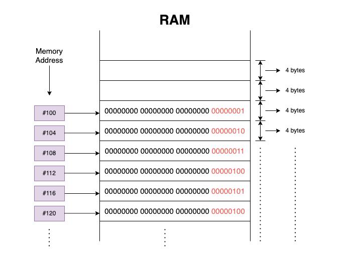
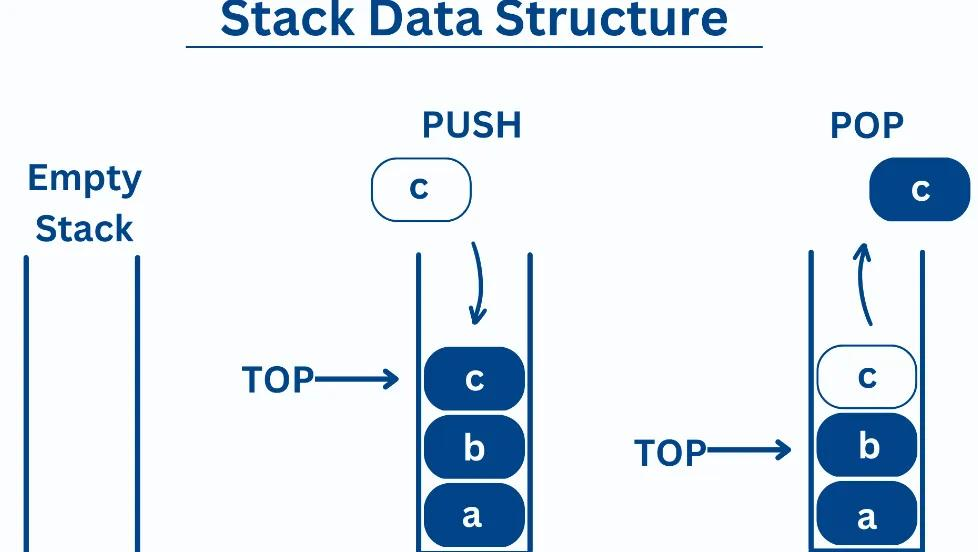

# RAM - Random Memory Access
What is RAM?
- It is the computer's short term working memory. When a program runs, it uses RAM to hold the data and instructions it needs. 

The important idea is that **memory has addresses, and data occupies space in memory.**

Why does RAM matter for data structures?
* Different data structures organize data in different ways. So the structure of memory is different. 
* Understanding memory helps explain why some operations are easy in one structure and more expensive in another.

# Static Array: 
Defenition: A static array is an array with a fixed capacity determined when it is created. Its size cannot simply grow or shrink during its lifetime.

How to create one in python? 
* Python lists are dynamic arrays.
* You can still represent the idea of a fixed-size array: 
    capacity = 4
    arr = [None] * capacity

    arr[0] = 10
    arr[1] = 20
    arr[2] = 30
    arr[3] = 40

    print(arr)  # [10, 20, 30, 40]

Summary: 
* Capacity is fixed.
* Elements are arranged in consecutive memory locations in the traditional array model.
* You can access elements directly using their indices.
* Inserting or deleting in the middle can require shifting elements.
* If the array is full, adding another element requires a different strategy.

# Dynamic array: 
Definition: A dynamic array is an array-like structure that can grow when more capacity is needed.

## Size versus capacity
* Size: The number of elements currently stored.
* Capacity: The number of elements that can fit in the current allocated storage before it needs to grow.
    * Ex: [1, 2, 3, empty]
    * size = 3, cap = 4

## Dynamic array operations in Python
    numbers = [10, 20, 30]

    # Add to the end
    numbers.append(40)

    # Read an element
    print(numbers[1])  # 20

    # Update an element
    numbers[1] = 99

    # Remove the last element and return it
    last = numbers.pop()

    # Insert at a particular index
    numbers.insert(1, 15)

    # Remove the element at index i
    del numbers[i]
    
    # looping through the list
    for number in numbers:
        print(number)

    for i in range(len(numbers)):
        print(numbers[i])

    print(numbers)

**Common interview question: Why not allocate a new array every time we append one element?**
- Becasue allocating a larger memoy address, and copying the elements every time we try to append is a lot of worka dn takes a lot of time. So we always mak esure to grow the cpacity by a factor of two, so that multiple future appends can use the same allocation.

# Stack: 
Defenition: A stack is a data structure that follows the principle of LIFO — Last In, First Out.

## The four fundamental stack operations:
1. `push(x)`: Adds an element to the top
    * Python lists don't have a built-in push() method, so we'll use append() to push an element.
2. `pop()`: Removes and returns the top element
3. `stack[-1]`: Returns the top element without removing it
4. `isEmpty()`: Checks whether the stack contains any elements

## Implementing a stack in Python: 
Consider: 
    stack = []

    # Push elements
    stack.append(10)
    stack.append(20)
    stack.append(30)

    print(stack)  # [10, 20, 30]

The end of the list represents the top of the stack.
* Pushing an element: 
    stack.append(40)

    print(stack)  # [10, 20, 30, 40]

* Popping an element: 
    top = stack.pop()

    print(top)    # 40
    print(stack)  # [10, 20, 30]

* Peeking the top element: 
    top = stack[-1]

    print(top)    # 30
    print(stack)  # [10, 20, 30]

* isEmpty():
    def isEmpty():
        if len(stack) == 0:
            print("Stack is empty")
        else:
            print("Stack is not empty")

**Look at Class implementation of Stack**

## When do we use stacks in coding interviews?
Stacks are especially useful when the most recently encountered item needs to be handled first.